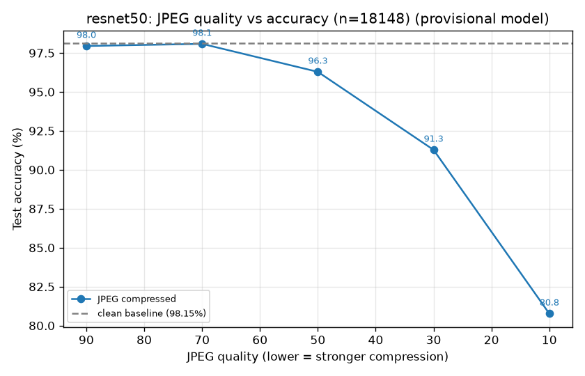
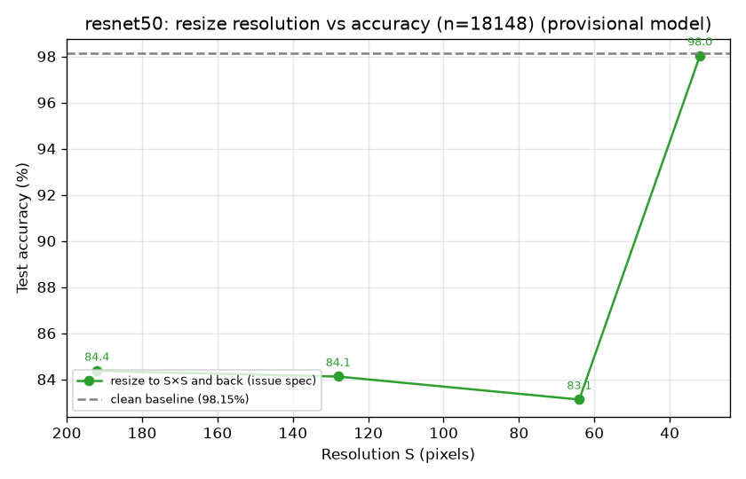
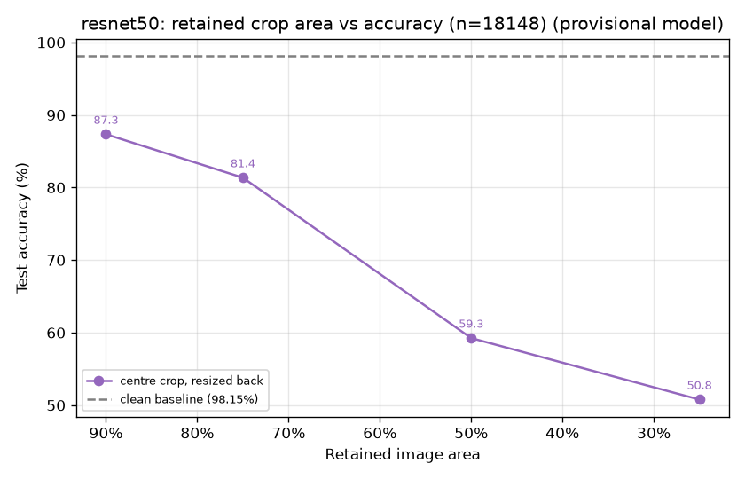
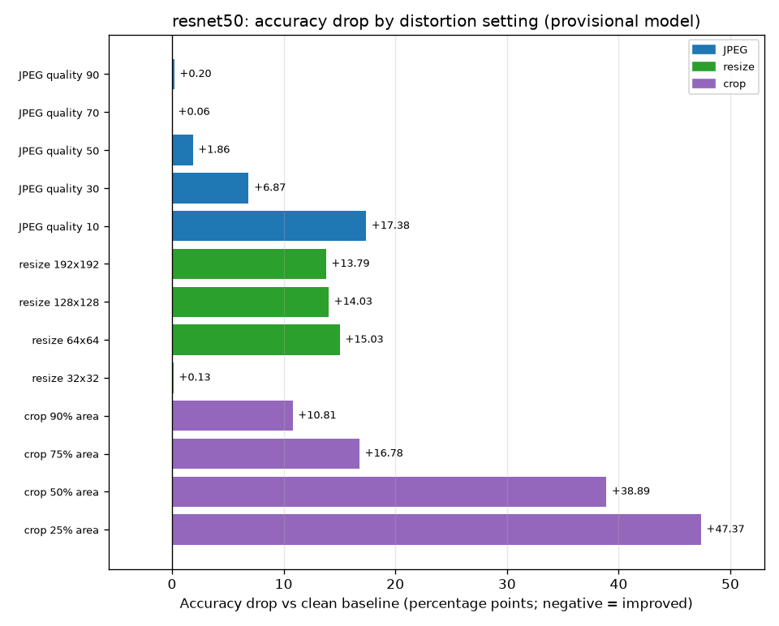

# Robustness to Compression, Resizing and Cropping (Issue #14)

**Status: provisionally complete.** All required distortions were evaluated on the full
in-distribution test set with the trained ResNet-50. The issue asks for "whichever model
performed better" in Issue #13; the CLIP linear probe has not yet been evaluated (its trained
checkpoint is not available locally), so ResNet-50 is used provisionally and the model-selection
step is still pending.

## 1. Objective

Apply JPEG compression, resizing and cropping to the test images, re-test the better-performing
model, and record how much accuracy drops for each distortion.

## 2. Model, checkpoint and test set

| Item | Value |
|---|---|
| Model | ResNet-50 (ImageNet init, 2-logit head), `models/resnet50.py` |
| Checkpoint | `checkpoints/resnet50_best.pth` (epoch 3, MD5 `288210d5e658ede62e83fd9bb3c8ce64`) |
| Label mapping | 0 = REAL, 1 = FAKE (checked against the checkpoint's `label_map`) |
| Test manifest | `splits/test.csv`, 18,148 images (9,074 real / 9,074 fake) |
| Composition | 18,000 CIFAKE (32×32 JPEG) + 148 GenImage BigGAN/SD v1.4 (128–640 px) |
| Test-set fingerprint | `3d26f4af18594018003f4d09155fb04a` (identical to Issue #13) |
| Holdout exclusion | 0 path or MD5 overlap with `splits/cross_generator_test.csv`; the script refuses the holdout manifest |
| Device | Apple Silicon MPS, batch size 64 |

**Why ResNet-50 (provisional).** In Issue #13, ResNet-50 reached 0.981486 accuracy and 0.998427
ROC-AUC. The CLIP linear probe was recorded as *blocked* because `checkpoints/clip_linear_best.pth`
is not available locally, so there is no verified comparison yet. ResNet-50 is the only model with
verified in-distribution results, not a confirmed winner.

## 3. Method

Each distortion is applied in memory to the **original** test image (never to an output of another
distortion), and before the model's standard preprocessing (Resize short side to 224, bicubic →
CenterCrop 224 → ImageNet normalisation). No image files are written or modified. All
transformations are deterministic, and every resampling step uses bicubic interpolation, the same
filter as the project preprocessing.

| Family | Levels | Procedure |
|---|---|---|
| JPEG | quality 90, 70, 50, 30, 10 | Pillow JPEG encode → decode in memory (default 4:2:0 chroma subsampling) |
| Resize | 192, 128, 64, 32 | original → S×S → back to original W×H (bicubic both ways) |
| Crop | 90, 75, 50, 25 % of area | centred crop with each side scaled by √area (rounded), resized back to original W×H |

For a 32×32 CIFAKE image the crops are 30×30, 28×28, 23×23 and 16×16. The resulting area fractions
across the test set average 0.879, 0.765, 0.516 and 0.250, because sides are whole pixels.

Accuracy uses the argmax prediction. ROC-AUC uses the continuous P(fake) = softmax(logits)[:, 1].
Drops are measured against the **re-measured** clean baseline:

```
accuracy_drop          = baseline_accuracy - distorted_accuracy
drop_percentage_points = accuracy_drop × 100        (negative = accuracy improved)
```

Every row was recomputed from the saved per-image predictions with
`python scripts/evaluate_robustness.py --verify`, and all 14 rows matched.

## 4. Clean baseline

| | Accuracy | ROC-AUC | Real acc. | Fake acc. |
|---|---|---|---|---|
| Issue #13 reference | 0.981486 | 0.998427 | — | — |
| Re-measured (this run) | **0.981486** | **0.998427** | 0.986775 | 0.976196 |

The re-run reproduces Issue #13 exactly (17,812 / 18,148 correct). Same checkpoint MD5, same test
fingerprint, same preprocessing.

## 5. Results (n = 18,148 for every row)

### JPEG compression

| Quality | Accuracy | ROC-AUC | Drop (pp) | Real acc. | Fake acc. |
|---|---|---|---|---|---|
| 90 | 0.979502 | 0.998246 | +0.20 | 0.9869 | 0.9721 |
| 70 | 0.980879 | 0.998344 | +0.06 | 0.9804 | 0.9814 |
| 50 | 0.962916 | 0.994628 | +1.86 | 0.9704 | 0.9555 |
| 30 | 0.912828 | 0.987269 | +6.87 | 0.9881 | 0.8376 |
| 10 | 0.807692 | 0.891219 | +17.38 | 0.7783 | 0.8371 |



### Resizing (S×S and back)

| Target | Accuracy | ROC-AUC | Drop (pp) | Real acc. | Fake acc. |
|---|---|---|---|---|---|
| 192×192 | 0.843619 | 0.991061 | +13.79 | 0.9952 | 0.6921 |
| 128×128 | 0.841195 | 0.989267 | +14.03 | 0.9918 | 0.6905 |
| 64×64 | 0.831221 | 0.987552 | +15.03 | 0.9915 | 0.6709 |
| 32×32 | 0.980218 | 0.998098 | +0.13 | 0.9849 | 0.9755 |



### Centre cropping

| Area kept | Accuracy | ROC-AUC | Drop (pp) | Real acc. | Fake acc. |
|---|---|---|---|---|---|
| 90 % | 0.873430 | 0.992782 | +10.81 | 0.9979 | 0.7490 |
| 75 % | 0.813643 | 0.987719 | +16.78 | 0.9976 | 0.6297 |
| 50 % | 0.592572 | 0.882541 | +38.89 | 0.9916 | 0.1935 |
| 25 % | 0.507825 | 0.490397 | +47.37 | 0.7809 | 0.2347 |



### Accuracy drop by setting



## 6. Discussion

**Cropping is the most damaging distortion.** Even a mild 90 % crop costs 10.8 points. At 50 % the
detector is barely better than guessing (59.3 %), and at 25 % it is at chance on both accuracy
(50.8 %) and ROC-AUC (0.49). Cropping removes content, and it also enlarges what remains, which
smooths out the high-frequency texture the model appears to rely on.

**JPEG compression is well tolerated at normal quality.** Quality 90 and 70 cost at most 0.2 points,
and quality 50 costs 1.9. Accuracy falls clearly only at quality 30 (−6.9) and quality 10 (−17.4).
Typical social-media re-encoding (about 70–85) should have little effect on this model.

**The resize result is mainly a resampling effect.** 18,000 of the 18,148 test images are 32×32
CIFAKE images, so for the 192, 128 and 64 settings the "downscale" is in fact an *upscale* followed
by a downscale back to 32×32. This round trip removes almost no information, yet accuracy drops by
about 14 points. At 32×32, the round trip leaves CIFAKE images unchanged, and accuracy is back to
98.0 %. In other words, the model is sensitive to the slight blur and ringing that bicubic
resampling introduces, not to a genuine loss of resolution. This also means the issue's resize
specification does not test real resolution loss on this dataset; see Limitations.

**The failures are one-sided.** Under resizing, cropping and JPEG quality 30, accuracy on real images
stays at about 98–100 %, while accuracy on fake images falls (to 19 % at a 50 % crop). Smoothing or
re-processing makes generated images look "real" to the model, so the main risk is missed fakes,
not false alarms. ROC-AUC stays high (0.987–0.993) for every resize setting and for the 90 % and
75 % crops, so the model still ranks images well. Much of the accuracy loss there comes from scores
shifting across the fixed 0.5 threshold, which means recalibrating the threshold would recover part
of it. This does not apply to the 50 % and 25 % crops or JPEG quality 10, where ROC-AUC itself
collapses.

**Ranking from most to least harmful** (accuracy drop, pp): crop 25 % (47.4) > crop 50 % (38.9) >
JPEG 10 (17.4) > crop 75 % (16.8) > resize 64 (15.0) > resize 128 (14.0) > resize 192 (13.8) >
crop 90 % (10.8) > JPEG 30 (6.9) > JPEG 50 (1.9) > JPEG 90 (0.2) > resize 32 (0.1) > JPEG 70 (0.1).

## 7. Limitations

- **Provisional model choice.** Only ResNet-50 was evaluated. If the CLIP linear probe turns out
  better in Issue #13, its robustness must be measured before Issue #14 is final.
- **Dataset dominated by 32×32 images.** 99.2 % of the test set is CIFAKE at 32×32, so the results
  mainly describe tiny, upsampled inputs. The 148 GenImage images are too few for separate
  conclusions. For reference, their accuracy fell from 0.939 clean to 0.541 at resize 64 and 0.838
  at crop 25 %.
- **Resize spec vs. genuine resolution loss.** As explained above, the S×S test does not reduce the
  resolution of 32×32 images. A supplementary relative-resize test (scale by S/224 and back) is
  implemented in the script (`--distortions resize_relative`) but was **not run**, to save time on
  limited hardware. No numbers are reported for it.
- **Fixed decision threshold** of 0.5; no recalibration was attempted.
- **One run, no confidence intervals.** The transformations are deterministic. With n = 18,148, the
  binomial standard error is about 0.1 pp near 98 % and about 0.4 pp near 50 %.
- Only centred crops and Pillow's JPEG encoder were tested; real platforms combine several
  operations.

## 8. Reproducing

```bash
# full run (resumable: completed settings are skipped; Ctrl-C safe between settings)
python scripts/evaluate_robustness.py --workers 0 --batch-size 64

# individual families
python scripts/evaluate_robustness.py --distortions jpeg
python scripts/evaluate_robustness.py --distortions resize crop

# supplementary relative-resize test (not run for this report)
python scripts/evaluate_robustness.py --distortions resize_relative

# recheck every CSV row against the saved predictions, rebuild charts
python scripts/evaluate_robustness.py --verify
python scripts/evaluate_robustness.py --charts-only

# tests
python -m unittest tests.test_evaluate_robustness -v
```

On an 8 GB Apple Silicon Mac each setting takes about 6–7 minutes at about 45 images/s. `--workers 0`
was faster than worker processes there because of memory pressure. Outputs:
`results/robustness_evaluation.csv` (one row per setting),
`results/robustness_predictions/*.csv.gz` (per-image predictions, about 0.15 MB each),
`results/robustness_charts/*.png`.

## 9. Pending: CLIP comparison

Once a trained CLIP linear-probe checkpoint is available:

1. `python scripts/evaluate_in_distribution.py --clip-checkpoint <path>` (Issue #13 comparison).
2. If CLIP scores higher, run
   `python scripts/evaluate_robustness.py --model clip_linear --clip-checkpoint <path>`.
   Its rows are added to the same CSV next to the ResNet-50 rows, and no code changes are needed.
3. Update this report's model selection and mark Issue #14 complete.
